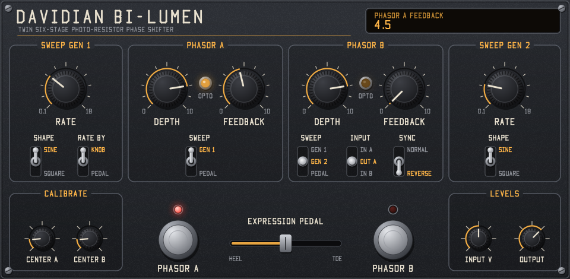

# Davidian Bi-Lumen

A Davidian LV2 circuit model of a DIY clone schematic by f.aiseur (rev 002, 2025-01-25). It has two six-stage LDR phasors with regeneration, two triangle/square sweep generators, the opto LED drivers, and LDR footswitch bypass. Stereo in and out (A and B), no latency.

Free software under the GNU GPL, version 3 or later: see [LICENSE](LICENSE), and [NOTICE.md](NOTICE.md) for third-party licences and sources. **Made with generative AI** (Claude Code): see [AI_USAGE.md](AI_USAGE.md). The build copies all three files into the bundle.

## Build and test on Windows

```
build.bat
build-test\test_dsp.exe build\bi_lumen.lv2
build-test\lilv_check.exe build
build-test\ui_check.exe build\bi_lumen.lv2
```

`build.bat` needs Visual Studio's C++ tools. `lilv_check.exe` checks the bundle with the lilv LV2 parser without installing anything. `ui_check.exe` hosts the GUI in a window and drives it with mouse messages.

## Install

Copy the whole `build/bi_lumen.lv2` folder (the plugin and GUI libraries and the two .ttl files) into one of the standard LV2 folders:

- Windows: `%APPDATA%\LV2` (current user) or `%COMMONPROGRAMFILES%\LV2` (all users)
- Linux: `~/.lv2` (current user) or `/usr/local/lib/lv2` (all users)
- macOS: `~/Library/Audio/Plug-Ins/LV2`

If your host doesn't scan that folder, add it to the host's LV2 search path or set the `LV2_PATH` environment variable. Close the host before copying and restart it afterwards. Replace any older copy instead of keeping two: when two bundles have the same URI, the loader uses one and ignores the other.

Look for **Davidian Bi-Lumen** in your host's plugin list. The plugin URI is `urn:davidian:bi-lumen`. It changed in the 2026-11 rename, so sessions saved before then need the plugin re-inserted.

## Other platforms

```
cmake -S . -B build-cmake
cmake --build build-cmake --config Release
ctest --test-dir build-cmake -C Release
```

The libraries get the right name for each platform (`.dll`, `.so` or `.dylib`). The code is plain C11 and needs no LV2 SDK. The Linux GUI needs the X11 development headers (`libx11-dev`). Only the Windows build has been compiled and tested.

## GUI



The bundle includes a native GUI (`bi_lumen_ui.dll`). It has no dependencies: it draws with its own anti-aliased software renderer and stroke font, and puts the result in a Win32 window (`ui:WindowsUI` on Windows) or an X11 window (`ui:X11UI` on Linux). macOS has no window layer yet, so CMake leaves the GUI out there and hosts show their generic controls.

- Drag a knob up or down to turn it. Hold Shift for fine control. Double-click resets it, and the mouse wheel works too.
- Click the upper, middle or lower part of a toggle to pick that position.
- Click a footswitch to switch that phasor on or off. Its red LED shows the state.
- Click or drag along the expression pedal slider.
- The amber OPTO lamps glow with each phasor's LED current, read from the plugin's `led_a` and `led_b` output ports.
- The readout shows the name and value of the last control you touched.

The artwork is original, to keep clear of copyright and trade dress. It uses the plugin's own name (Bi-Lumen), lettering, colours and graphite finish, and none of the original unit's logo, wordmark or panel artwork. Only the functional grouping follows the circuit, as described in the owner's manual. The font is drawn from scratch in `src/ui/font.h`.

`build-test\ui_render.exe out.bmp` renders the panel to an image without opening a window, on any platform.

## Controls

| Control | Range | Default | Circuit part |
|---|---|---|---|
| Sweep 1 Rate | 0.1–18 Hz | 0.5 | VR1 (B25k). Set in Hz; the plugin works out the pot position |
| Sweep 1 Shape | Sine / Square | Sine | SW3 |
| Sweep 1 Rate Control | Knob / Pedal | Knob | SW2 "Rate control" |
| Sweep 2 Rate | 0.1–18 Hz | 0.3 | VR3 (A25k) |
| Sweep 2 Shape | Sine / Square | Sine | SW4 |
| Phasor A / B Depth | 0–1 | 0.8 | VR2 / VR4 (B10k), "Sweep vol" |
| Phasor A / B Feedback | 0–1 | 0 | VR5 / VR6 (B10k) |
| Phasor A Sweep | Gen 1 / Pedal | Gen 1 | SW6 |
| Phasor B Sweep | Gen 1 / Gen 2 / Pedal | Gen 1 | SW5 |
| Sweep Sync | Normal / Reverse | Normal | SW7, U16B inverter |
| Phasor B Input | In A / Out A / In B | Out A | SW1 |
| Phasor A / B On | on/off | on | SW8 / SW9 footswitches |
| Pedal | 0–1 | 0.5 | Expression input, 0–5 V |
| Center A / B Trim | 0–1 | 0.15 | TR3 / TR4 (the "??" trims). Moves the whole sweep up or down |
| Volts at 0 dBFS | 0.1–10 | 1.0 | The voltage a full-scale digital signal represents |
| Output | -24 to +12 dB | 0 dB | Not on the unit |
| Enabled | on/off | on | Host bypass with a 20 ms crossfade |

"Sine" is the triangle wave. The LED driver curves it, so the sweep sounds rounded. "Square" is the RC-rounded square. The SW3 labels on the schematic are on the opposite throws: the throw labelled "square" gets the triangle through R118. The plugin names each position by the waveform it actually passes.

With the default Out A setting, Out B is all twelve stages in series.

## How the circuit works

- **Audio path (per phasor):** C1/R15 (390k input impedance), U1A buffer, then U1B inverting with the feedback injected on its + input. Six all-pass stages follow, each with 6.8 nF and an LDR in parallel with 220k. C20 470 nF then feeds the VR5 feedback pot and the U2B inverter. U2A mixes the result with the dry signal: dry through R50 12k, wet through R16 + TR1 + C21 + R49. Notches fall where the wet and dry signals cancel.
- **Bypass:** R16 on the schematic is an LDR. The footswitch lights LDR-DRIVE-A1 at 7.2 mA, which turns R16 on and lets the wet signal reach the mix. With the switch off, R16 goes dark and only the dry signal is left (wet leak about -45 dB). The LDR's own lag fades the effect in and out without a click.
- **Sweep 1:** a voltage-controlled triangle/square oscillator (U13 rectifier and inverter, D8–D11 bridge, U12B integrator, U12A Schmitt trigger). TR8 sets its slowest rate.
- **Sweep 2:** a fixed op amp function generator (U15).
- **LED drivers:** each is U11 with a BC550C follower. D4 in the feedback network expands the curve, so the LED current rises faster near the top of the sweep.

## Checks against the schematic and published specs

| Item | Model | Source |
|---|---|---|
| Sweep 1 rate range | 0.100–21.6 Hz | Owner's manual: 0.1–18 Hz |
| Sweep 2 rate range | 0.094–19.7 Hz | Owner's manual: 0.1–18 Hz |
| Input impedance | 390k, or 195k with B on In A | Manual: 390k single, 180k parallel |
| Pedal voltage | 0–5 V | Polyphony, Feb 1978: pedal sends 0–5 V |
| Phasor structure | 2 × 6 stages, 12 in series | Manual |
| Phasor B sweep source | Gen 1 / Gen 2 / Pedal; Sync Normal/Rev | Manual |

The upper rate limits come out 10–20% above the manual's figure. That fits the RC4558's real output swing and the trim positions. `test_dsp` also compares the simulated audio path with the schematic's s-domain transfer function. They agree to within 0.04% across LDR values, feedback settings and sample rates.

Default sweep (Center 0.15, Depth 0.8): the LED current runs from 0.28 to 10.2 mA. The lowest notch sweeps from about 205 Hz to 1.5 kHz, with the others at about 3× and 10× that. Feedback adds peaks of about +4.7 dB between the notches.

## Values not on the schematic

These are estimates. Tune them by ear, or measure your own parts:

- **LDR response** (`src/opto.h`): R = 25k at 1 mA LED current, scaling with current to the power -0.75. Dark resistance 2 MΩ, 5 ms attack and 25 ms release. The LED and LDR are hand-coupled 5 mm parts with no stated values, and this sets the sweep range more than anything else.
- LED forward voltage 2.0 V and RC4558 swing ±13.5 V (`src/opto.h`, `src/circuit.h`).
- Trim positions: TR5/TR6 500 Ω, TR8 0.5 (which gives the manual's 0.1 Hz minimum), TR9 11k, TR10 8.5k (matches Sweep 2's level to Sweep 1), TR7 0. TR1/TR2 are set so the wet and dry mix resistors match (about 1.6k).
- The Center trims default to 0.15. At the schematic's midpoint the top of the sweep drives U11 into saturation.

## Simplifications

- Op amps are ideal apart from clipping at U1B, U2B and U2A.
- All six LDRs in a module are identical.
- The LED indicator transistors (Q1, Q4) and D7 in the pedal rate path are left out. They don't affect the sound.
- The pedal rate path tops out near 1 Hz, as the R91/R88 divider dictates.

## Code layout

| File | Contents |
|---|---|
| `src/phasor.h` | One phasor's audio path, solved per sample including the feedback loop |
| `src/opto.h` | LED driver (U11, Q2, D4 network) and LDR model |
| `src/sweep.h` | Sweep generators, pedal CV, depth pots |
| `src/plugin.c` | LV2 entry points, routing, controls |
| `src/circuit.h` | Shared constants and op amp clipping |
| `src/ports.h` | Port numbers shared by the plugin and the GUI |
| `src/ui/panel.h` | GUI layout, drawing and mouse handling, with no platform code |
| `src/ui/canvas.h`, `src/ui/font.h` | Software renderer and stroke font |
| `src/ui/ui_lv2.c` | LV2 UI entry points and the Win32 and X11 window layers |
| `src/lv2_abi.h` | The LV2 C interface, so no SDK is needed |
| `bundle/` | LV2 metadata |
| `LICENSE`, `NOTICE.md`, `AI_USAGE.md` | GPL-3.0 text, third-party licences and sources, AI usage statement |
| `test/test_dsp.c` | Transfer function, sweep rates and sweep range checks, plus tests of the built library |
| `test/lilv_check.c` | Checks the bundle with the lilv LV2 parser (Windows only) |
| `test/ui_check.c` | Hosts the built GUI and drives it with mouse messages (Windows only) |
| `test/ui_render.c` | Renders the panel to a .bmp file |

## Sources

- [Owner's manual of the original unit (Soundgas)](https://soundgas.com/resources/mutron-biphase-owners-manual): rates, input impedance, switch functions
- [Polyphony, Feb 1978: modifying the original unit (muzines)](https://www.muzines.co.uk/articles/modifying-the-mu-tron-bi-phase/12300): pedal voltage range
- [Effects Database entry for the original unit](https://www.effectsdatabase.com/model/musitronics/mutron/biphase): background

## Licence

Copyright (C) 2026 Davidian. Released under the GNU General Public License, version 3 or (at your option) any later version. Every source file carries an `SPDX-License-Identifier` line. `src/lv2_abi.h` is under the ISC licence, which is GPL-compatible, because it reproduces the LV2 interface declarations. [NOTICE.md](NOTICE.md) lists every licence and source. [AI_USAGE.md](AI_USAGE.md) says how AI was used.
